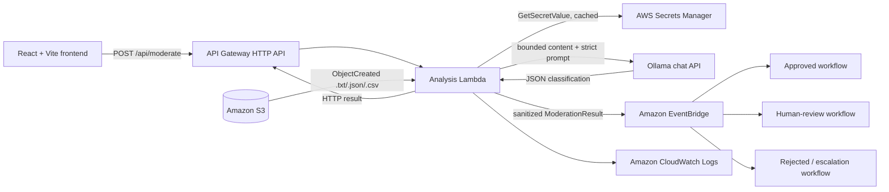

# ILA

## AI-Powered Event-Driven Content Moderation System

ILA classifies user-generated text as `approved`, `rejected`, or `review`. It pairs a production-oriented React dashboard with one shared moderation service: browser requests arrive through API Gateway, file uploads arrive through Amazon S3, and both paths use the same validated Ollama classification and fail-safe safety rules.

## Overview

The browser submits bounded text to `POST /api/moderate`. API Gateway invokes the analysis Lambda, which calls Ollama, normalizes the response, applies deterministic safety overrides, and returns a typed result. The Lambda can also publish the result to Amazon EventBridge without publishing the source text.

Files uploaded to S3 invoke the same Lambda and moderation function. This keeps interactive and event-driven decisions consistent. Model, parsing, secret, or network failures never silently approve content: they return or publish a human-review result.

## Features

- React 19, TypeScript, Vite, and Tailwind CSS frontend
- Responsive neo-brutalist dashboard, moderation form, session history, analytics, architecture, and project information
- Live API/Ollama health state with no simulated online status
- One shared moderation path for HTTP requests and S3 uploads
- Controlled categories, severity, confidence, and escalation fields
- Human-review routing for ambiguity, low confidence, and service failures
- Code-enforced escalation for rape threats and child sexual abuse content
- High-priority handling for actionable self-harm and animal-abuse classifications
- API Gateway, Lambda, S3, Secrets Manager, EventBridge, and CloudWatch deployment through AWS SAM
- Prompt-injection resistance, bounded input, strict output validation, and no hardcoded credentials
- Current-tab session history only; no fake database or persistence claims

## Architecture



Source content is returned only to the requesting browser flow and is not placed on EventBridge. Published events contain classification data and, for S3 uploads, the object location.

## AWS Services

- **Amazon API Gateway HTTP API** exposes `GET /api/health` and `POST /api/moderate` to the frontend with an explicitly configured CORS origin.
- **AWS Lambda** handles HTTP and S3 events, invokes Ollama, validates output, and publishes normalized events.
- **Amazon S3** stores uploaded input objects and emits object-created notifications.
- **AWS Secrets Manager** stores the Ollama API key as a plain string or `{"api_key":"..."}` and is read only by the Lambda.
- **Amazon EventBridge** receives compact results for downstream routing.
- **Amazon CloudWatch** receives lifecycle and error logs; content and credentials are not logged.

## API

### `GET /api/health`

Returns the API state, configuration state, most recently observed Ollama state, event-pipeline state, and configured input limit. `unknown` means no model request has been observed by that warm Lambda instance; it is not presented as online.

### `POST /api/moderate`

Request:

```json
{"content":"Text to classify"}
```

Successful response:

```json
{
  "decision": "review",
  "confidence": 0.55,
  "categories": [],
  "severity": "medium",
  "reason": "Context is ambiguous.",
  "escalate": true
}
```

Malformed, empty, and oversized requests return typed `4xx` errors. Upstream moderation failures return a valid fail-safe `review` result rather than an approval.

## Moderation Pipeline

1. Validate an HTTP request or S3 event and enforce the configured content bound.
2. For S3, accept `.txt`, `.json`, or `.csv`; invalid or empty objects route to review.
3. Retrieve the Ollama key from Secrets Manager in AWS and cache it only for the warm invocation. Local development defaults to unauthenticated local Ollama.
4. Send a deterministic chat request with policy in the system role and untrusted content inside explicit delimiters.
5. Parse the response and allow only known decisions, severities, and categories.
6. Clamp confidence to `0..1`; low-confidence decisions become `review` unless a critical override requires rejection.
7. Force `rape_threat` and `child_sexual_abuse` to rejected/severe/escalated. Force model-classified actionable `self_harm` and `animal_abuse` to rejected/high/escalated.
8. Return the HTTP result and, when enabled, publish a sanitized event. EventBridge failures raise so Lambda retry/DLQ behavior can apply.

## Folder Structure

```text
ila/
├── frontend/
│   ├── src/
│   │   ├── components/           # reusable UI and moderation components
│   │   ├── lib/                  # API abstraction and tab-session storage
│   │   ├── pages/                # six application views
│   │   └── types/                # API domain types
│   ├── .env.example
│   ├── package.json
│   └── vite.config.ts
├── lambda-functions/
│   └── analysis-lambda/
│       ├── index.py              # HTTP/S3 handlers and AWS orchestration
│       ├── moderation.py         # prompt, parsing, normalization, policy
│       └── ollama_client.py      # standard-library HTTP client
├── scripts/
│   ├── dev_api.py                # local HTTP adapter for the Lambda handler
│   └── test_moderation.py
├── tests/                         # backend unit tests
├── artifacts/ui-audit/           # visual audit report and evidence
├── .env.example
├── requirements-dev.txt
└── template.yaml
```

## Backend Environment Variables

| Variable | Default | Purpose |
|---|---:|---|
| `OLLAMA_URL` | `https://ollama.com/api/chat` | Reachable Ollama chat endpoint; AWS Lambda cannot use your laptop's `localhost`. |
| `OLLAMA_MODEL` | `gemma4:31b-cloud` | Model sent to Ollama. |
| `OLLAMA_AUTH_MODE` | `secrets_manager` | `secrets_manager` in AWS; local adapter defaults to `none`. `environment` is local-only. |
| `OLLAMA_SECRET_NAME` | `ila/ollama_api_key` | Existing Secrets Manager secret name. |
| `OLLAMA_API_KEY` | empty | Local `environment` auth or CLI script only; never expose it to the frontend. |
| `EVENT_BUS_NAME` | `ila-event-bus` | EventBridge bus; SAM injects the created bus name. |
| `PUBLISH_HTTP_EVENTS` | `true` | Publish successful HTTP classifications to EventBridge. Local adapter defaults to `false`. |
| `API_ALLOWED_ORIGIN` | `http://localhost:5173` | Exact allowed browser origin. |
| `MAX_CHARS` | `8000` | Maximum characters sent to Ollama. |
| `CONFIDENCE_THRESHOLD` | `0.70` | Lower-confidence approve/reject results become review. |
| `OLLAMA_TIMEOUT_SECONDS` | `15` | Outbound request timeout. |
| `LOG_LEVEL` | `INFO` | Python log level. |

The application does not auto-load `.env`; set values in the shell or deployment configuration.

## Frontend

### Framework used

The client uses React 19 with TypeScript 6 and Vite 8. It uses a typed API layer, runtime response validation, request timeouts, accessible semantic controls, and hash-based navigation that works on static hosts without server rewrite rules.

### Tailwind CSS

Tailwind CSS 4 is integrated through its Vite plugin. The stylesheet defines project tokens through `@theme`; there is no additional component library or runtime CSS dependency.

### Neo-Brutalist Design System

The interface uses a warm paper background, black three-pixel borders, offset hard shadows, condensed display headings, monospaced operational labels, and a deliberately small signal palette. Yellow marks attention, blue marks primary actions, green marks healthy/approved state, orange marks review, and contrast-safe red marks failure/rejection. Controls retain visible focus outlines, layouts reflow at mobile widths, and status is never communicated by color alone.

Session history and analytics are derived only from successful requests made in the current browser tab and are clearly labeled as such. Refreshing or closing the tab clears that data.

### Frontend environment variables

| Variable | Default | Purpose |
|---|---:|---|
| `VITE_API_BASE_URL` | empty | API Gateway base URL in production. Empty uses relative `/api`, proxied locally by Vite. Do not include a trailing slash. |
| `VITE_API_TIMEOUT_MS` | `30000` | Browser request timeout in milliseconds. |

Only `VITE_` variables are bundled into browser code. Never place credentials or the Ollama API key in them.

## Installation

Python 3.11 or newer is recommended; AWS deploys Python 3.12. Node.js 20.19+ or 22.12+ is required by Vite 8.

Windows PowerShell:

```powershell
python -m venv .venv
.venv\Scripts\Activate.ps1
python -m pip install --upgrade pip
pip install -r requirements-dev.txt

cd frontend
npm install
```

## Run Backend

Start a local Ollama server and make `llama3.1:8b` available, or set `OLLAMA_URL` and `OLLAMA_MODEL` before starting the API.

```powershell
cd D:\ila
.venv\Scripts\Activate.ps1
python scripts\dev_api.py
```

The adapter listens on `http://127.0.0.1:8787`, uses the production Lambda handler, defaults to unauthenticated local Ollama at `http://localhost:11434/api/chat`.

## Run Frontend

```powershell
cd D:\ila\frontend
npm install
npm run dev
```

Open `http://localhost:5173`. Vite proxies `/api` to the local backend, so no frontend environment variable is required.

## Full Local Development

Run the backend command in one terminal and the frontend command in a second terminal. Keep both processes running, then use `http://localhost:5173`; every browser request is proxied to the real local Lambda handler at port `8787`.

To exercise normalization without AWS or Ollama:

```powershell
cd D:\ila
.venv\Scripts\Activate.ps1
python scripts\test_moderation.py "This is example text" --mock approved
```

## Testing

Backend tests mock AWS and HTTP and require neither credentials nor a live model:

```powershell
cd D:\ila
.venv\Scripts\Activate.ps1
python -m pytest -v
python -m compileall -q lambda-functions scripts tests
python -m pip check
```

Frontend checks:

```powershell
cd D:\ila\frontend
npm test
npm run lint
npm run build
```

The screenshot-backed UI audit is in [`artifacts/ui-audit/audit-report.md`](artifacts/ui-audit/audit-report.md).

## Production Build

Deploy the backend first and read its `ApiBaseUrl` output. Build the static frontend against that URL:

```powershell
cd D:\ila\frontend
$env:VITE_API_BASE_URL = "https://YOUR_API_ID.execute-api.YOUR_REGION.amazonaws.com"
npm ci
npm run build
```

Deploy the generated `frontend/dist/` directory to the static host of your choice (for example S3 + CloudFront or Amplify Hosting). Configure `AllowedFrontendOrigin` to that host's exact `https://` origin. The frontend needs no server runtime and stores no secret.

## AWS Integration and Deployment

Prerequisites: configured AWS CLI credentials, AWS SAM CLI, and an Ollama endpoint reachable from Lambda. If Ollama is private, attach the function to the appropriate VPC and routing; that environment-specific network configuration is intentionally not guessed.

Create the secret once. Avoid placing a real key in source control or browser environment variables:

```powershell
aws secretsmanager create-secret --name ila/ollama_api_key --secret-string '{"api_key":"REPLACE_SECURELY"}'
```

Validate, build, and deploy the API and event pipeline:

```powershell
cd D:\ila
sam validate --lint
sam build
sam deploy --guided
```

During guided deployment, provide `OllamaUrl`, `OllamaModel`, `OllamaSecretName`, and the final `AllowedFrontendOrigin`. SAM creates the HTTP API, private encrypted input bucket, Lambda, least-privilege policies, EventBridge bus, and S3 notifications. The stack output `ApiBaseUrl` is the value for `VITE_API_BASE_URL`.

For CI or repeat deployment, use explicit parameters appropriate to the environment:

```powershell
sam build
sam deploy --parameter-overrides AllowedFrontendOrigin=https://YOUR_FRONTEND_HOST OllamaUrl=https://YOUR_OLLAMA_ENDPOINT/api/chat OllamaModel=llama3.1:8b OllamaSecretName=ila/ollama_api_key
```

Inspect outputs and exercise the S3 path:

```powershell
aws cloudformation describe-stacks --stack-name YOUR_STACK --query "Stacks[0].Outputs"
aws s3 cp sample.txt s3://YOUR_GENERATED_BUCKET/demo/sample.txt
```

The Secrets Manager secret is the only manually required AWS resource because its value must never be embedded in the template. Static frontend hosting and downstream EventBridge targets are deployment choices and are not silently invented by this repository.

## EventBridge Routing

Events use source `ila.moderation` and detail type `ModerationResult`. Example patterns:

```json
{"source":["ila.moderation"],"detail-type":["ModerationResult"],"detail":{"decision":["approved"]}}
```

```json
{"source":["ila.moderation"],"detail-type":["ModerationResult"],"detail":{"decision":["review"]}}
```

```json
{"source":["ila.moderation"],"detail-type":["ModerationResult"],"detail":{"decision":["rejected"]}}
```

```json
{"source":["ila.moderation"],"detail-type":["ModerationResult"],"detail":{"escalate":[true]}}
```

## Security

- API keys are read from Secrets Manager, cached only in process memory, and never logged, emitted, or sent to the browser.
- SAM permissions are scoped to `s3:GetObject` on the generated bucket, `secretsmanager:GetSecretValue` for the configured secret, `events:PutEvents` on one bus, and standard Lambda logging.
- The input bucket blocks public access and uses server-side encryption.
- The system prompt treats content as untrusted data; JSON is parsed as data and never executed.
- File extensions, event shape, content bounds, output fields, category names, confidence, and request bodies are validated.
- External-service, parsing, and unexpected moderation failures route to review and never default to approval.
- CORS permits only the configured frontend origin; add application authentication and authorization before exposing moderation to untrusted public clients.

For production, also configure identity/authentication, rate limiting, WAF as appropriate, log retention, S3 lifecycle policies, DLQs/destinations, alarms, KMS customer-managed keys if required, concurrency limits, and a network-controlled model endpoint.

## Limitations

- LLM moderation can produce false positives and false negatives. High-risk systems require trained human oversight, evaluation, appeals, and jurisdiction-specific processes.
- Category overrides depend on the model returning a controlled category; they are hardening, not an independent classifier.
- The health endpoint reports configuration and the last model observation for a warm Lambda instance, not a synthetic Ollama probe.
- Browser history is deliberately tab-scoped and is not durable or shared across devices.
- The SAM CLI was not available in the development environment used for this implementation, so SAM deployment commands are documented but were not executed here.
- Not yet scaled to the full extent of Content Moderation by humans and Emulation Moderation by AI Agents
