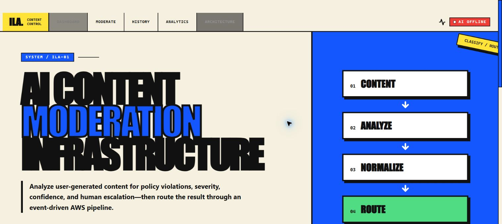
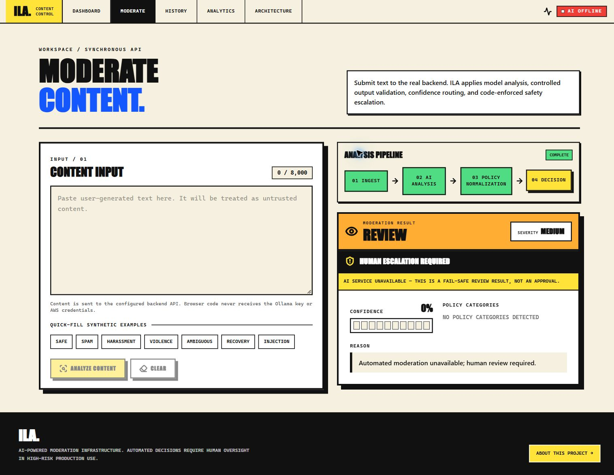
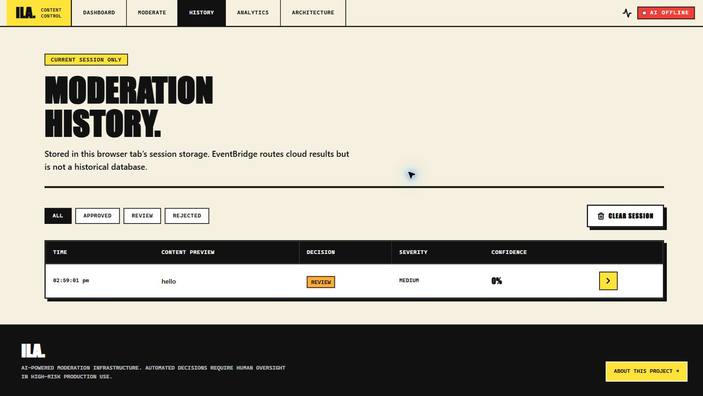
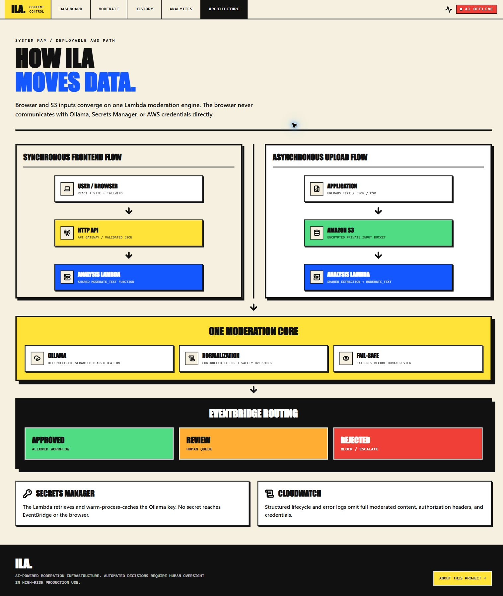
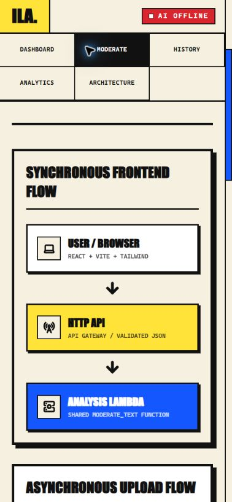

# ILA UI Audit

Audit date: 2026-10-08  
Scope: live React application at desktop and mobile widths, connected to the real local Lambda HTTP adapter.  
Method: screenshot-led visual review plus code inspection for semantics, focus treatment, and honest data/state labeling.

## Step 1 — Dashboard and system status

**General health: Healthy**

- The dashboard establishes a distinctive neo-brutalist visual system with strong hierarchy, consistent borders and shadows, and clear operational language.
- The status badge is backed by the real health endpoint. It distinguishes unchecked, online, offline, misconfigured, and API-offline states instead of assuming success.
- Primary actions are visually obvious and use semantic buttons.

## Step 2 — Moderation and fail-safe state

**General health: Healthy**

- A live moderation request was exercised while Ollama was unavailable.
- The interface surfaced `REVIEW`, zero confidence, escalation, and the model-service failure reason; it did not manufacture an approved result.
- Decision, severity, escalation, reason, categories, and confidence are visually separated and remain understandable without relying only on color.

## Step 3 — Session history

**General health: Healthy**

- The real result appears in history and analytics only after a request.
- The UI explicitly labels this as current-tab session data. No database, durable history, or sample metrics are implied.
- The desktop table uses proper table structure; narrow layouts use a card presentation.

## Step 4 — Architecture communication

**General health: Healthy**

- The browser, API Gateway, Lambda, S3, Ollama, Secrets Manager, EventBridge, and downstream paths are represented without decorative fake integrations.
- Security boundaries and the fail-safe review behavior are explained adjacent to the flow.

## Step 5 — Responsive layout and navigation

**General health: Healthy after correction**

- The architecture flow stacks cleanly and remains legible at a mobile viewport.
- Audit finding corrected: the navigation originally used horizontal overflow, which could conceal later routes. It now wraps into a three-column mobile grid and returns to a horizontal desktop layout.
- Audit finding corrected: the original signal red produced approximately `3.86:1` contrast with white. The token is now `#d9252d`, approximately `4.94:1`, clearing WCAG AA for normal white text.

## Accessibility and interaction checks

**General health: Good, with runtime assistive-technology validation still recommended**

- A keyboard skip link targets the main content.
- Controls have visible `:focus-visible` outlines, form labels, status text, semantic headings, and descriptive button names.
- Responsive behavior was visually verified at desktop and mobile widths.
- Screenshot review cannot prove screen-reader announcements, every keyboard-order edge case, or behavior under browser zoom. Those should be included in pre-release manual QA.

## Evidence limits

- Ollama was not running during the captured live request, so the evidence intentionally demonstrates the fail-safe review path rather than a model-generated approval or rejection.
- AWS deployment and API Gateway behavior were not captured because the AWS SAM CLI was unavailable in this environment.
- The screenshots document the local implementation and are not claims about a deployed production environment.
